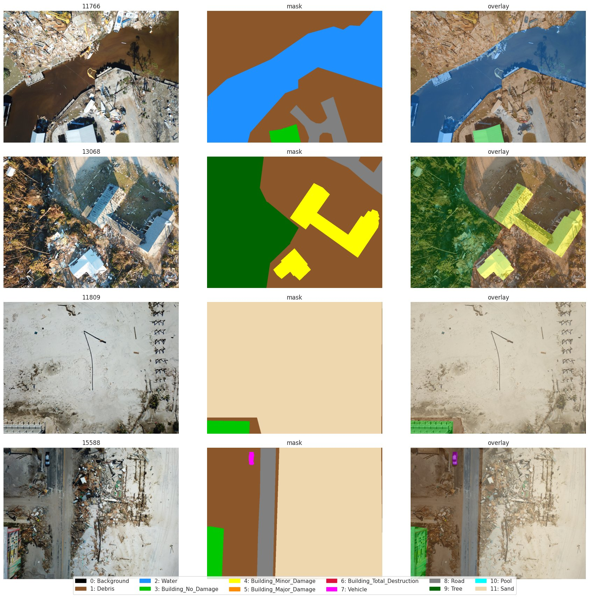
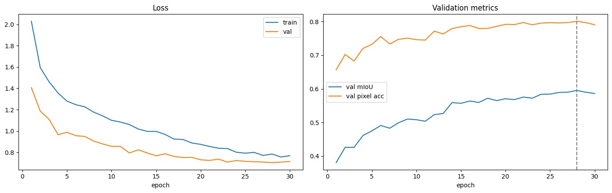
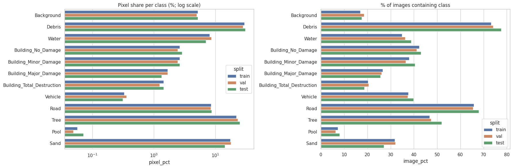
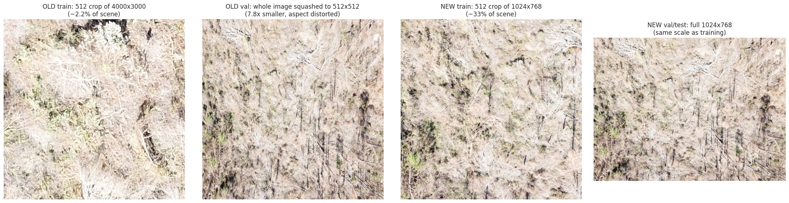
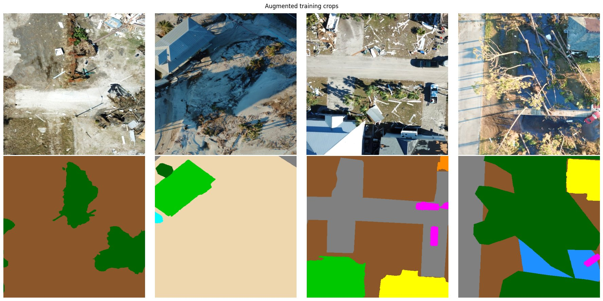

# RescueNet: Post-Disaster Damage Segmentation from UAV Imagery


This project does pixel-level semantic segmentation of high-resolution drone imagery taken after **Hurricane Michael**. Each pixel gets one of 12 classes, including **four building-damage levels** (no damage, minor, major, total destruction), plus debris, water, roads, vehicles and other scene classes. Damage maps like these can help responders decide where to send help first.

The project has two Kaggle notebooks:

| # | Notebook | What it does |
|---|----------|--------------|
| 01 | [`01_eda_and_preprocessing.ipynb`](notebooks/01_eda_and_preprocessing.ipynb) · [Kaggle](https://www.kaggle.com/code/hisambhav/rescuenet-preprocessing) | Explores all 4,494 image/mask pairs, checks the labels, measures class imbalance, resizes the data once at 4:3 scale and computes class weights for the loss |
| 02 | [`02_training_deeplabv3plus_resnet50.ipynb`](notebooks/02_training_deeplabv3plus_resnet50.ipynb) · [Kaggle](https://www.kaggle.com/code/hisambhav/02-rescuenet-training-new/notebook) | Trains a **DeepLabV3+ model with an ImageNet-pretrained ResNet-50 encoder** using mixed precision, a warm-up + cosine learning-rate schedule, a weighted CE + Dice loss, early stopping and checkpoints that can be resumed |

<p align="center">
  
</p>

---

## Results

The model was trained for 30 epochs on one NVIDIA Tesla T4 (about 162 s per epoch, about 1.4 h in total). Validation uses the **full 1024×768 images**, at the same scale as training.

| Model | Encoder | Params | Best val mIoU | Val pixel acc. | Best epoch |
|-------|---------|-------:|--------------:|---------------:|-----------:|
| DeepLabV3+ | ResNet-50 (ImageNet) | 26.7 M | **0.5954** | **0.8011** | 28 / 30 |

<p align="center">
  
</p>

The full per-epoch log (learning rate, losses, mIoU, pixel accuracy and epoch time) is in [`results/training_history.csv`](results/training_history.csv).

---

## Dataset

[**RescueNet**](https://www.nature.com/articles/s41597-023-02799-4) (Rahnemoonfar et al., *Scientific Data*, 2023) contains UAV images collected after Hurricane Michael, with dense pixel-level labels.

| Split | Pairs | Native resolution |
|-------|------:|-------------------|
| Train | 3,595 | 4000×3000 (a few at 4056×3040) |
| Val   |   449 | 〃 |
| Test  |   450 | 〃 |

**Classes (12):** `Background`, `Debris`, `Water`, `Building_No_Damage`, `Building_Minor_Damage`, `Building_Major_Damage`, `Building_Total_Destruction`, `Vehicle`, `Road`, `Tree`, `Pool`, `Sand`

The classes are **very imbalanced**. In the training set, the most frequent class (Debris, about 29.7% of pixels) is about **523×** more common than the rarest (Pool, about 0.06%).

<p align="center">
  
</p>

---

## Pipeline

### 1. EDA & preprocessing ([notebook 01](notebooks/01_eda_and_preprocessing.ipynb))

- **Robust pairing:** each image is matched to its mask by **file stem** (`xxx.jpg` ↔ `xxx_lab.png`), not by sorted position, so one missing file cannot misalign every later pair.
- **Integrity checks:** the notebook reads the header of every file (dimensions, modes, image/mask size mismatches) and scans every full-resolution mask for label values outside 0–11.
- **Distribution analysis:** pixel share per class, the share of images that contain each class, a class co-occurrence matrix, per-image class area, and RGB channel statistics.
- **One-time offline resize to 1024×768.** This keeps the 4:3 aspect ratio, and both sides are divisible by 32. Images use `INTER_AREA` and masks use `INTER_NEAREST`, so no new label values are created. After resizing, the class balance changes by at most **0.03 percentage points**.
- **Class weights:** median-frequency balancing clipped at 10, plus a gentler inverse-sqrt variant. Both are computed from the resized training masks.
- **Packaging:** the outputs are bundled into a single `tar`, because Kaggle will not save notebook outputs that contain more than 500 files.

**Why resize offline?** Training directly on the 12 MP originals had three problems:

| Problem | Effect |
|---|---|
| Decoding 12 MP JPEG + 12 MP PNG on every step | The GPU was idle while it waited for the DataLoader |
| Train = 512 crop at full resolution; Val = whole image squashed to 512×512 | Validation ran at about **7.8× a different scale**, with a distorted aspect ratio, so its scores were misleading |
| A 512 crop of a 4000×3000 image covers about 2% of the scene | Too little context; a whole building often did not fit in a crop |

<p align="center">
  
</p>

### 2. Training ([notebook 02](notebooks/02_training_deeplabv3plus_resnet50.ipynb))

| Component | Choice |
|-----------|--------|
| Architecture | DeepLabV3+ (`segmentation-models-pytorch`) |
| Encoder | ResNet-50, ImageNet weights |
| Train input | Random-resized 512×512 crops (about 0.7–1.4× zoom around native scale), horizontal/vertical flips, 90° rotations, brightness/contrast and HSV jitter |
| Val input | Full 1024×768 images, no resizing |
| Loss | Weighted cross-entropy (median-frequency weights, clipped) + multiclass Dice |
| Optimizer | AdamW (lr 3e-4, wd 1e-4), gradient clipping at 1.0 |
| Schedule | Linear warm-up for 1 epoch, then cosine decay to 1% of the peak LR, stepped every batch |
| Precision | Mixed precision (fp16 autocast + GradScaler), `channels_last` memory format |
| Batch | 6 training / 2 validation on one T4 |
| Metrics | mIoU and pixel accuracy from a confusion matrix built on the GPU |
| Model selection | Best val mIoU checkpoint; early-stopping patience of 8 |

<p align="center">
  
</p>

---

## Engineering notes

These are the problems I ran into on Kaggle and how I fixed them:

- **RAM leak with `nn.DataParallel`.** On 2× T4, the main process grew by about 10 GB of system RAM per epoch, and Kaggle killed the kernel in epoch 3. Training now runs on **one GPU** and stays steady at about 3 GB of RAM. As a safeguard, system RAM is checked every 50 steps, and the run stops cleanly (and can be resumed) if usage goes above a set limit.
- **Lighter data transfer between processes.** DataLoader workers return **`uint8`** tensors. Converting to float, normalizing and casting to `long` all happen on the GPU, which makes the batches passed between processes 4–8× smaller. Per-epoch timing showed about **1 s waiting for data versus about 128 s of GPU compute**, so the GPU, not the input pipeline, is the bottleneck.
- **Copy-on-write safety.** File paths are stored as NumPy string arrays instead of Python lists, which avoids reference-count-driven memory growth in forked workers.
- **Fault tolerance.** Checkpoints are written atomically (`.tmp` → `os.replace`). Training **resumes automatically** from an attached `last_checkpoint.pth`, restoring the model, optimizer, scheduler, scaler and history. The LR schedule is re-aligned if the steps per epoch have changed. A time budget stops training cleanly before Kaggle's 12-hour session limit.

---

## Repository structure

```
.
├── notebooks/
│   ├── 01_eda_and_preprocessing.ipynb          # EDA, validation, resizing, class weights
│   └── 02_training_deeplabv3plus_resnet50.ipynb # DeepLabV3+ / ResNet-50 training
├── assets/                                     # Figures exported from the notebooks
├── results/
│   └── training_history.csv                    # Per-epoch metrics of the reported run
├── requirements.txt
├── LICENSE
└── README.md
```

---

## Reproducing

The notebooks are written for **Kaggle** (paths under `/kaggle/input` and `/kaggle/working`).

1. **Notebook 01:** attach the [RescueNet dataset](https://www.kaggle.com/datasets/yaroslavchyrko/rescuenet) and run all cells. A GPU is not needed; the run takes about 13 minutes on 4 CPU cores. It produces `rescuenet_resized.tar` (about 2.1 GB), `manifest.csv`, `dataset_info.json`, `class_weights.npz` and `figures/`.
2. **Notebook 02:** attach notebook 01's output (*Add Input → Your Work*). Turn on a **GPU (T4 or P100)** and **Internet** (for the `segmentation-models-pytorch` package and the ImageNet weights), then run all cells. It produces `best_model.pth`, `last_checkpoint.pth`, `history.csv` and `training_config.json`.
3. **Resuming:** if a run is interrupted, attach that run's output as an input and run again. Training continues from the last finished epoch.

To try a different model, change `arch` / `encoder` in `CFG`, for example `Unet` + `efficientnet-b3`, or `FPN` + `tu-convnext_tiny`.

To run locally, install the dependencies with `pip install -r requirements.txt` and change `DATA_ROOT` / `WORK_DIR` at the top of each notebook.

---

## Roadmap

- [ ] Notebook 03: evaluate on the held-out **test split**, with per-class IoU, a confusion matrix and qualitative prediction overlays
- [ ] Sliding-window / test-time-augmentation inference at native resolution
- [ ] Encoder comparison (ResNet-34, EfficientNet, ConvNeXt) and other architectures (UNet++, SegFormer)
- [ ] Merge the damage classes for a building-level damage-assessment metric

---

## Citation

If you use the dataset, please cite the original authors:

```bibtex
@article{rahnemoonfar2023rescuenet,
  title   = {RescueNet: A High Resolution UAV Semantic Segmentation Dataset for Natural Disaster Damage Assessment},
  author  = {Rahnemoonfar, Maryam and Chowdhury, Tashnim and Murphy, Robin},
  journal = {Scientific Data},
  volume  = {10},
  pages   = {913},
  year    = {2023}
}
```

## License

The code in this repository is released under the [MIT License](LICENSE). The RescueNet dataset is **not** included and is covered by its own license and terms of use.
